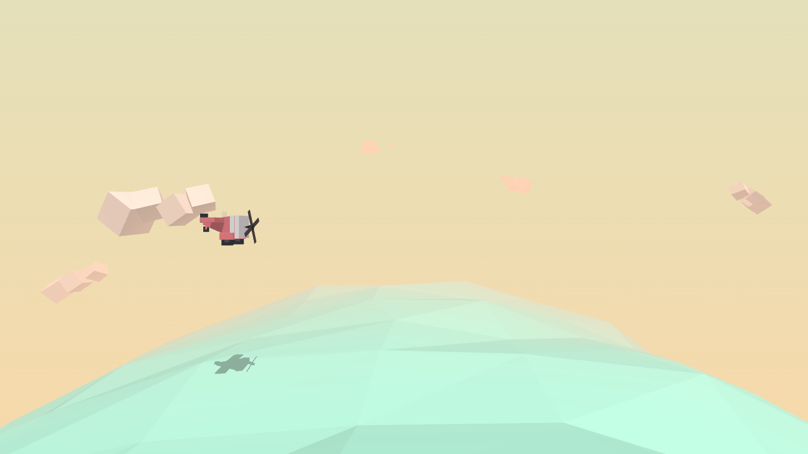
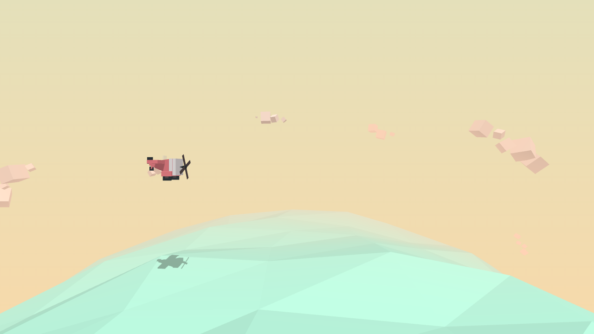
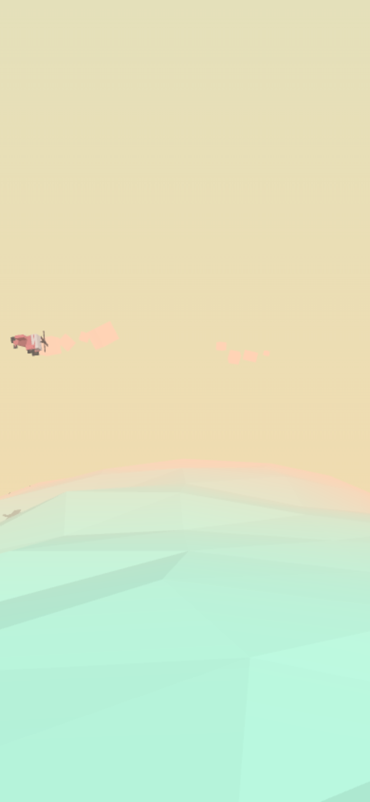

# Review and performance results

The rewrite keeps the original low-poly aircraft, pastel palette, rolling sea,
clouds, meteors, mouse/touch steering and Space-on-release shooting. Desktop
framing is preserved; portrait framing now keeps the plane visible.

## Measured comparison (2026-11-08)

Run `npm run benchmark`. It reads the original source and its bundled Three.js
r115 directly from git commit `38a9533`, builds both versions with the same
esbuild, and runs them in Chromium with **SwiftShader software WebGL**, 1280×720,
DPR 1, random seed 42 and controlled 60 Hz simulation steps. Original flight
progress is exercised by overriding its clock delta, without changing its update
logic. The modern app uses `Game.tick`. Both render real WebGL scenes.

The recorded source SHA-256 in [measurements-final.json](measurements-final.json)
identifies the measured modern `src/` contents. `workingTreeDiffers: true` means
the optimisation was measured before its final commit. The earlier migration
checkpoint is in [measurements-migration.json](measurements-migration.json);
that first harness held original speed at 0.49, so use the final paired results
for comparisons rather than combining samples across runs.

| Metric | Original | Final rewrite |
| --- | ---: | ---: |
| Draw calls after 120 warmup ticks | 35 | 28 |
| GPU geometries after warmup | 29 | 13 |
| GPU geometries after 60 rendered shots + drain | 215 | 16 |
| GPU geometries after 120 rendered shots + drain | 341 | 16 |
| Shadow map width × height | 4096² | 2048² |
| Comparable esbuild JS bytes, gzip | 156,667 | 141,375 |
| Median simulation tick, ms | 0.0355 | 0.0328 |
| Median tick + render + WebGL finish, ms | 0.6 | 0.5 |
| 95th percentile tick + render + finish, ms | 2.5 | 1.4 |
| Triangles in warmup frame, including shadow passes | 1,288 | 3,148 |

The main demonstrated gains are **bounded geometry usage**, 20% fewer draw
calls in the sampled frame, 75% fewer shadow-map texels and approximately 10%
less compressed JS in the same bundler comparison. The actual Vite production
JS is 555,309 bytes (about 139 kB gzip), plus a small HTML/CSS file and favicon.
Vite reports a >500 kB chunk warning because the WebGL renderer is loaded at
startup; no feature can usefully defer it in this single-scene game.

CPU timings are seven batches of 600 update steps. Full-frame timings are 45
samples including `gl.finish()`. Resource stress runs render each of 60 firing
bursts (five update steps between shots), then advance 1,800 steps to drain,
and repeat. Normal meteor spawning continues throughout. The retained geometry
count includes live/pool resources; it is **not a byte measurement of total GPU
memory**. The cloud batch draws extra offscreen blocks in exchange for fewer
draw calls, which explains the triangle increase. Software rendering, host
load, browser timing precision, seeded scene differences and changed resource
lifetimes affect timings. **These results do not establish an FPS improvement
on real hardware**; the median full-frame timings were close in this lab run.

## Implemented changes

- Strict types and explicit ownership replace mutable global modules and cyclic
  Game/Input/Weapon/Meteor dependencies. Tests can exercise objects without WebGL.
- `BufferGeometry` replaces removed `Geometry.vertices`, `CubeGeometry` and
  `mergeVertices` APIs. The tapered aircraft corners and 442 welded sea vertices
  are regression-tested. Wave buffers upload once per tick; flat normals stay
  correct through shader derivatives.
- Clouds share one geometry/material and one `InstancedMesh`, with independent
  block motion, rotating ring and conservative bounds.
- Bullets/meteors share their geometry and materials and reuse released objects.
  Teardown disposes each owned geometry/material/instance buffer, shadow map,
  renderer, animation loop, resize observer and event listener.
- Collision arithmetic avoids per-pair cloned vectors and unnecessary square
  roots. Relative swept projectile tests detect moving-target crossings and
  choose the first hit, preventing tunnelling and one shot removing many targets.
- Fixed simulation steps preserve 60 Hz motion at 30/60/144 Hz display cadence.
  Background/context-loss pauses reset the accumulator, preventing catch-up.
  Long frames are clamped to 100 ms rather than fast-forwarding the whole game.
- Exact plane/meteor overlaps cannot divide by zero. Meteors enter on their
  orbital path; expired/offscreen projectiles leave by world-space camera bounds.
  Speed checkpoints use crossings rather than exact modulo matches.
- Camera projection updates only when FOV/aspect changes. Narrow portrait
  viewports retain a square viewport's horizontal flight area.
- Pointer events cover mouse, pen and touch; steering is measured relative to the
  game surface. Space does not scroll the page or fire while editing a field.
  Unsupported WebGL displays a readable message. Embedded startup posts the
  existing Hub readiness acknowledgement without exposing test hooks.

## Verification

`npm run check` passes strict TypeScript checking, production build, **20
logic/regression tests and 12 Chromium/WebGL browser checks**. The browser
suite covers the production entry, steering/firing, resize, touch and portrait
visibility, background pause, real context loss/restoration, repeated recreation,
rendered GPU-resource stability, swept hits, entry-listener cleanup, embedded readiness and unsupported
WebGL fallback. Original/final desktop screenshots and the phone capture were
visually inspected. Browser logs were checked for startup errors.

The Docker image builds successfully with Node 22. Its isolated, network-less
container passed nginx configuration and HTTP smoke checks with the expected
framing header, and contains no test harness. Compose validates, publishes no
ports and uses the external `web` network. `npm audit --omit=dev` reports no
known production dependency vulnerabilities at this check. No live deployment
or default-branch merge is part of this delivery.

## Remaining recommendations

1. Profile physical iPhone/Safari, Android and desktop GPUs before adding adaptive
   shadow resolution or higher device pixel ratios. Current pixel ratio remains
   1, as in the original, prioritising the same render workload.
2. Add render interpolation if smooth 120/144 Hz presentation becomes a priority.
   The fixed simulation currently renders the latest state without interpolation.
3. Retain the simple projectile × meteor scan for today's small scene. Introduce
   spatial broad-phase indexing only if future enemy/projectile counts warrant it.
4. Revisit per-cluster cloud culling if much denser scenes make the extra instanced
   triangles expensive. Current geometry counts are small.
5. Touch movement is preserved; firing still uses Space. An on-screen fire
   control, restart/score UI or new gameplay belongs to the next feature scope.

## Visual comparison

Original source:

Rewritten scene:

Portrait capture (touch steering):

